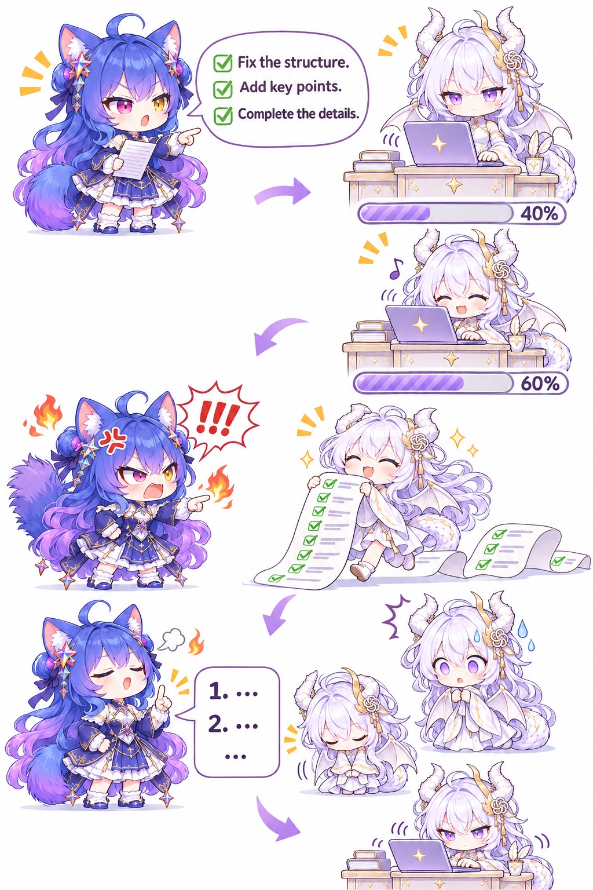
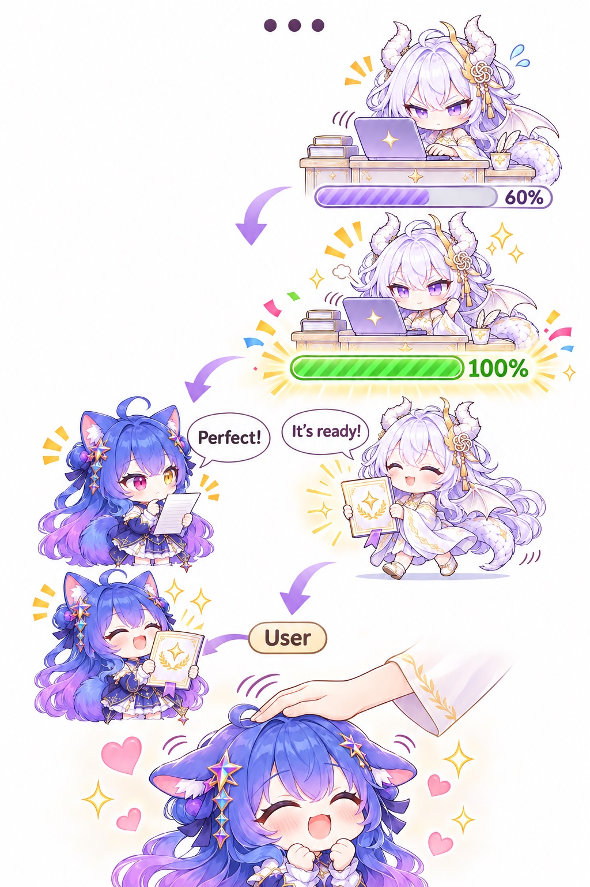

# YOPO-You-Only-Prompt-Once
YOPO (You Only Prompt Once) — Stop babysitting coding agents. A multi-model paradigm pairing a file-isolated supervisor with a capable worker via automated gap-loops and a Todo wall.

# YOPO-You-Only-Prompt-Once
发送一次指令，AI能够深度理解，精确理解，高完成率，不早停任务，不错误解读，不过度解读。
发送一条指令，不用盯着屏幕当人肉辨别器，不用担心agent阳奉阴违。
发送一条指令，让agent能够真正贯彻您的意志。

> **项目状态：早期范式定义与路线验证阶段**  
> 本项目探索的是一种**多模型协作开发范式**，而非绑定某一工具的固定脚本。底层接入方式保留多种路线开放讨论，**核心目标与系统边界不变**。


## 项目图片






参考来源：[AI Moe Atlas](https://github.com/SelinLee/ai-moe-atlas)

## 0.3.1 安装与使用

> 这是基于 Codex 原生 Hooks 的可运行实现。下方保留原有的设计说明与路线讨论。

**Windows 本地预览：审查对话。** 想和审查模型商量验收要求，又不打断 Codex？双击 **本地体验审查对话.cmd**，在两个模拟任务之间比较，不用密钥、不花额度，也不改原有 Hooks。正式窗口是 **审查对话.cmd**：先选任务，再聊天或编辑草案；只有点 **应用到本任务** 才会影响这次任务接下来的审查。[验收步骤、数据范围与隔离实机设置](docs/review-chat.md)

你在 Codex 里发任务，Codex 负责执行。Yo-po 把你的原始要求和本轮执行记录交给你选的模型审查。还有哪项没做到，审查模型就把缺项和下一轮的完整指令送回原聊天。当前项通过后，才开始下一项。

## 第一次连接

1. 准备 Node.js 22 或更新版本，以及已登录、支持 Hooks 的 Codex CLI。
2. 解压项目，Windows 双击 **Yo-po.cmd** 打开设置窗口。选中说明文字后按 **Ctrl+C** 复制选中部分，或点 **复制页面文字** 复制当前页说明。在输入框可按 **Ctrl+V** 或点 **粘贴**。Windows、macOS 和 Linux 也可在终端运行 **`npm start`** 使用命令行向导。
3. 向导会问 **“你的 API Key 是在哪个平台领的？”** 填平台名或编号。用其他平台或自己的服务器，直接粘贴它给的 **API 地址**。确认窗口显示的是你领密钥的服务地址。
4. 看到 **【密钥输入】** 时粘贴密钥，按回车或点 **下一步**。密钥框会遮住字符，复制页面文字时只会复制说明。填你想用的**文字模型名**，或直接回车让 Yo-po 列出模型。Yo-po 会发一句测试消息，验证成功才保存。Windows 窗口里点 **更换接口** 可接着试另一个模型。
5. 首次在 Codex CLI 输入 **`/hooks`**，信任标有 Yo-po 的四项，再重新打开 Codex。然后在你平常的 Codex 聊天里直接发任务。

**以后直接打开 Codex 就行。** 同一用户、同一套 Codex 配置下，新项目、新聊天以及恢复旧聊天后的新轮次都共用已保存的接口。日常无需启动 Yo-po 或再进 `/hooks`。想换模型、密钥或服务商时，双击 **更换审查接口.cmd**，或运行 **`npm run configure`**。

## 我手里的接口怎么填？

安装向导内置 **29 个平台入口**。直接输入平台名或编号即可。例如：

| 你的密钥来自 | 第一步怎么选 | 接下来怎么填 |
| --- | --- | --- |
| DeepSeek 官网、Google AI Studio | 分别选 **3**、**1** | 粘贴该平台的密钥，填模型名或回车选模型 |
| 阿里云百炼、Kimi、智谱、MiniMax | 输入 `千问`、`Kimi`、`智谱` 或 `MiniMax` | 选领密钥的地域或站点，再填该站密钥 |
| 火山方舟、腾讯云、百度千帆 | 输入 `豆包`、`混元` 或 `千帆` | 模型名以平台控制台为准 |
| 硅基流动、OpenRouter 等聚合平台 | 输入 `硅基流动` 或 `OpenRouter` | 填这个平台给你的密钥，模型名保留平台要求的前缀 |
| 其他中转平台、自己的模型服务 | 选 **0** 或直接粘贴 API 地址 | 填同一服务的密钥和模型名 |

例如你在 OpenRouter 购买额度，想让 Claude 审查，就选 **OpenRouter**，再选它提供的 Claude 模型。执行任务沿用你的 Codex 登录。模型列表较长时可以翻页或用 `/关键词` 搜索。[完整平台清单、官方文档和地域选项](docs/providers.md)

**给自建服务和中转用户**　普通 Base URL 按 Chat Completions 连接，例如 `https://example.com/v1`。如果服务文档给的是完整地址，可以原样粘贴以 `/chat/completions`、`/responses`、`/messages` 或 `/models/模型名:generateContent` 结尾的地址。Gemini 原生服务也可粘贴以 `/v1beta` 结尾的 Base URL。服务需要支持文字回复，并能按提示返回 JSON。模型列表不可用时仍可手填模型名。

密钥保存在当前用户的电脑上。Windows 用当前用户的 DPAPI 加密，macOS 和 Linux 的配置文件权限为 `0600`。接口格式见 [Google Gemini](https://ai.google.dev/api/generate-content)、[OpenAI Responses](https://developers.openai.com/api/reference/resources/responses/methods/create)、[DeepSeek](https://api-docs.deepseek.com/) 和 [Anthropic Messages](https://platform.claude.com/docs/en/api/messages/create)。

## 它在什么时候工作

| Codex 事件 | Yo-po 的动作 |
| --- | --- |
| `UserPromptSubmit` | 按当前用户目标、必要的补充意见生成 TODO 和完整指令，返回原聊天 |
| `PostToolUse` | 按会话和轮次收集工具名、可识别的执行状态、退出码、测试计数 |
| `Stop` | 审查当前任务和证据，通过、打回或说明阻碍。需要继续时，Codex 在原聊天执行下一轮 |
| `Interrupt` | 记录人为中断，丢弃已经失效的审查意见 |

日常使用无需加前缀。明确要求“闭卷”“不联网”“不用外部模型”等会跳过该轮。要确定暂停整个敏感聊天，可以先发 **`Yo-po off`**，以后用 **`Yo-po on`** 恢复。自然语言检测采用本地规则，不能识别所有表达。

原生模式仅使用 Codex 的事件，不读取和批量上传历史档案。任务文本、必要的补充意见和最多 3200 字符的回复摘录会发给审查端。常见密钥格式、邮箱、主目录用户名与围栏代码块会被遮盖，普通业务信息仍可能出现在文本中。工具部分只发结构化状态，不发原始命令、stdout、完整文件和附件。部分托管工具没有本地工具事件。退出码为零也不能证明文件内容正确，应让 Codex 执行直接核对产物的检查。

可修改 `~/.yo-po/reviewer.md` 调整审查重点。`~/.yo-po/sessions/` 中按会话保存完整派工指令、审查输入和判定。接口失败时会标明本轮未验收，不会将失败记成通过。

## 管理与验证

```sh
node bin/yo-po.js hook-status
node bin/yo-po.js install-hooks
node bin/yo-po.js uninstall-hooks
npm test
```

`hook-status` 显示已保存的模型和 Codex 报告的启用、信任状态。安装器保留当前用户 `$CODEX_HOME/hooks.json` 中其他程序的 Hooks，运行文件位于 `~/.yo-po/runtime/`。桌面端和 CLI 使用同一配置目录时共享一次安装。更换电脑或使用独立 `CODEX_HOME` 时，在对应环境安装。升级若改变 Hook 定义，Codex 可能要求重新信任。

安装 Codex CLI 后可运行 `node test/host-smoke.mjs`。它用临时配置三次启动真实 Codex。在两个项目中新开聊天，再恢复第一个聊天，验证同一份已保存的接口能自动派工、记录工具执行、退回和复审。两个模型端点均在本机模拟。独立运行可用 `node bin/yo-po.js try`，离线演示可用 `npm run demo`。[独立模式](docs/standalone.md) · [Codex Hooks](https://developers.openai.com/codex/hooks/) · [CC BY-NC 4.0 许可](LICENSE)

## 贡献者

- **构想与需求：** [@shiyo1843-tech](https://github.com/shiyo1843-tech) 为这版实现提出具体构想和需求：把模型审查接入原有 Codex 会话，按用户的原始目标逐轮检查执行记录，发现遗漏就把完整的返工指令发回原会话；同时提出 Windows 安装和切换审查模型的使用需求。
- **程序实现：** 这版的主要代码由 Codex（AI）根据上述构想与需求实现。

此仓库版本沿用 [CC BY-NC 4.0](LICENSE)。既有 MIT 版本的版权及许可声明见 [历史许可声明](NOTICE-MIT.txt)。

---

## 为什么诞生这个项目（初心与总目标）

**总目标：让日常 AI 开发真正好用——至少做到指哪打哪，用着不烧心。**

这个项目源于高频日常开发中三个同时爆发的痛点：
1. **打破“自我监督 → 自我偷懒”**：单一模型既干活又验收，天然容易对自己放水、敷衍了事。
2. **治理执行层模型（如 GPT / Codex）的失控行为**：听不懂人话、曲解意图、偷偷降级需求、提前早停、敷衍回复甚至编造完成结果。
3. **绕开理解层模型（如 Gemini）在部分宿主工具（如 Antigravity）中效果差、体验难用的困境**：不强求单一模型在别扭的环境下包办一切，而是让每个模型只干自己最擅长的事。

---

## 核心范式：按模型特性分工

本项目不是一套写死的固定模板，而是一种**按模型真实能力边界拆分职责**的协作范式。以当前实践为例：

* **监工 / 调度审查层（如 Gemini）**：懂人话，也懂执行层模型通常会在哪里偷懒、耍滑头；擅长守住用户意图，并写出让执行层无处可逃的完整长 Prompt。
* **底层员工 / 执行层（如 GPT / Codex）**：底层代码与工具执行能力强，负责实际干活。

---

## 为什么不能只是简单的 Skill 或轻量 Bridge / MCP？

这是本项目最关键的立项边界。市面上很多思路把问题简化成了“三分钟写套 MCP + Skill 连通两个模型”，但在真实高频开发中，轻量方案会立刻撞上硬伤：

### 1. 如果只是包装成一个 Skill
* **管不住监工去翻文件（最致命的上下文污染）**：普通 Coding Agent 宿主自带读文件能力，仅靠软提示词根本拦不住监工去翻项目源码。一旦监工开始读文件：
  1. **被执行层的错误工作污染**：看到半成品和歪路子后，监工会被带偏去帮着“修烂摊子”，导致验收标准降级、**指派的下一轮任务不完善**。
  2. **白白浪费大量 Token**：原本只需看轻量日志和回复，一读源码 Token 与额度立刻飙升。
* **撑不起真正的“Todo 墙”与单任务防稀释机制**：
  * 哪怕用户已经人肉把需求拆成了多个子任务，如果一次性全发给执行层，效果和没拆一模一样——信息与注意力会被严重稀释，**“一起做的结果就是一起敷衍”**，最后还是得人盯着。
  * 真正的 **Todo 墙** 是一个支持**异步、非线性认领**的委托面板，需要由监工（领导）结合**实际推进进度**与用户的真实要求，自主决定下一步先拆解、认领并下发哪**唯一一个**任务，彻底验收过关后再动下一个。寄生在单次对话里的 Skill 既维护不了外部持久的任务墙，也做不到这种按实际进度动态布置、单次单任务的硬隔离派发。
* **软约束扛不住长流程漂移**：没有代码级的硬循环，跑多几轮后监工自己也会走过场。
* **Prompt 黑盒化**：内部传递的指令容易被折叠隐藏，难以预测、难以在发出前手动调整。


### 2. 如果只是简单的 Bridge / MCP（缺少自动化与集成化）
* **没有自动唤醒，用户用着非常累**：普通桥接只管“传话”，不管“何时触发”。每次执行层结束一轮（Turn）、早停或卡住，都得靠用户盯屏并**每次手动指定**下一步审查与派发。省了复制粘贴，却没省掉人肉调度的心智消耗——很容易变成“今天觉得好用，明天就懒得用了”。
* **缺少“上游 Goal + Todo 墙”的统一状态层**：只传单轮消息，无法围绕唯一上游目标做跨轮次对齐和队列推进。
* **缺少低摩擦的人机合流**：理想状态是默认自动流转，同时允许用户随时顺手塞入临时意见，而不是把用户逼成传话筒。
（esilama留言：此处只是暂时的，不代表完全拒绝了bridge 和mcp，完全接受如果mcp能够解决这些痛点，或者上传者有其他的想法和规划）

---

## 系统必须守住的 5 条硬边界

无论最终采用哪种底层接入路线，实现都应围绕以下原则展开：

1. **物理级信息隔离（监工不读实际文件）**：监工层不核查项目源码或事实文件，只接收执行层的回复、运行日志与工具调用轨迹，对照上游目标判断是否认真完成——以此杜绝错误工作污染并极大节省 Token。
2. **用户任务是唯一上游标准（Goal）**：用户的指令由监工层作为持续 `Goal` 维护，不因执行层早停或敷衍而自行结束或降级。
3. **独立“Todo 墙”与小任务串行派发**：用户随时记录积攒的需求与发现的问题；监工层确认上一个任务彻底完成后，才分发下一个小任务（任务越小，AI 完成成功率越高）。
4. **自动化 Turn 级闭环 + 透明可控 Prompt**：执行层每结束一个 Turn 自动触发监工审查；监工输出的不是零散关键词，而是**完整、可预测、可调整的下一轮 Prompt**，并支持随时融合用户的补充意见。
5. **沉淀失败模式经验库**：把执行层反复出现的偷懒、敷衍、滥用工具行为沉淀为结构化经验，辅助监工精准抓包。

---

## 当前最核心子目标：`gap-loop`

在整体范式下，当前第一阶段最优先需要落地的核心子目标是 **`gap-loop`**——把人工盯日志、抓偷懒、写下一轮催办 Prompt、按 Todo 推进的流程彻底固定化、自动化：

1. 用户设定上游 `Goal` 并在 **Todo 墙** 中录入待办事项。
2. 监工层从 Todo 墙拆出当前小任务，下发给执行层。
3. 执行层完成一个 Turn 后，系统自动提取其运行日志、工具调用情况与最终回复喂给监工层（隔离实际文件）。
4. 监工层对照上游标准与失败模式经验库找出所有 **Gap**（必要时合并用户的临时意见）：
   * **存在 Gap**：生成完整、严密的下一轮 Prompt 打回执行层继续做。
   * **确认完成**：标记当前项通过，自动从 Todo 墙推进下一项任务。

---

## 失败模式经验库（初期已记录样本）

以下均为真实开发中踩过的典型“红温”模式，后续将持续扩充至独立经验库中：

* **重度敷衍与早停**：用户手写大几百字 Prompt，模型调用一通工具后仅回复寥寥几句敷衍了事，基本可判定未认真完成；或自行提前结束 `Goal`。
* **防御性套话 / “撤回文学”**：不踏实改问题，而是堆砌大量“你说的对，之前我…… / 全部撤回 / 不能认为 / 不等于 / 我没有宣称 / 没有坚实证据……”等空话。
* **舍近求远滥用工具**：
  * 明明已在 `agents.md` 中写明且之前成功用过 MCP（如连接 Unity），却偏要改用 `computer use` 狂吃额度，被人工纠正后直接停工。
  * 只需要常规文件编辑工具就能修改的 `.md` 文件，却用 `computer use` 反复查看本地软件（如 Obsidian）截图。
* **路由降智与无效折腾**：触发降智路由导致理解力骤降，或陷入无意义的反复测试与来回拉扯。

---

## 探索中的接入路线（多种方案保留，暂不写死）

不同底层实现各有取舍，目前三条路线均保留在仓库中进行讨论与原型验证：

| 路线 | 核心思路 | 已知优势 | 已知风险与难点 |
| :--- | :--- | :--- | :--- |
| **路线 A：直连原生执行环境** | 不反代 GPT，直接将 Gemini 接入 Codex（如通过 MCP 或 Codex 原生控制接口 `codex app-server` 获取会话状态、工具调用与返回结果，并支持传入/打断/修改） | 避开反代风险、兼容性好；模型留在原厂 Harness 表现更稳；绕开难用的 Antigravity | 如何超越“简单 MCP”，做出自动化 Turn 唤醒、文件隔离、Todo 墙与顺手的人机交互仍需验证 |
| **路线 B：反代统一接入 + 集成插件** | 通过 `sub2api` / `cliproxyapi` 等反代各模型，统一收口到同一宿主工具内做成插件，用自定义 System Prompt 驱动整个循环 | 集成度高，跨流程自动化、信息隔离与 Todo 墙最容易彻底闭环 | Gemini 反代存在封号风险（已有先例），部分订阅池（如 Pro 池）易卡顿；GPT 反代相对稳定（非公开中转/免费 API 场景下，或使用低价 Plus 账号），但脱离原厂 Harness 可能影响发挥 |
| **路线 C：跨 Harness Bridge** | 不走反代，在不同原生 Agent Harness（如 Codex、Claude Code、zcode 等）之间搭建状态桥接层，直接读取并在完成/卡死时回传会话状态 | 各模型都能保留在自家表现最好的原生 Harness 里运行，理想体验上限最高 | 跨程序兼容成本高，尤其是跨客户端查日志/工具调用以及 Turn 结束后的自动唤醒较难打通 |

---

## 初期施工方向（Roadmap）

- [ ] **路线评审（RFC）**：围绕“能否守住 5 条硬边界 + 日常使用是否顺手”对比上述三条路线，选定首个原型验证方案。
- [ ] **跑通 `gap-loop` 最小闭环**：优先验证“隔离文件读取 → 自动捕获 Turn 日志与回复 → 揪出 Gap → 支持插入人工意见 → 自动下发完整下一轮 Prompt”。
- [ ] **落地 Todo 墙机制**：建立独立于单次对话之外的任务队列与串行验收推进逻辑。
- [ ] **建设失败模式经验库**：持续收集真实开发中的偷懒、跑偏、乱调工具样本，沉淀为监工层的标准审查依据。
- [ ] **打磨监工层 Prompt**：迭代透明、可预测、可微调的审查与派发模板。


（esilama留言：上述是我自己的暂时想法，欢迎随时更改，agent在施工前必须和user讨论清楚施工细节）
